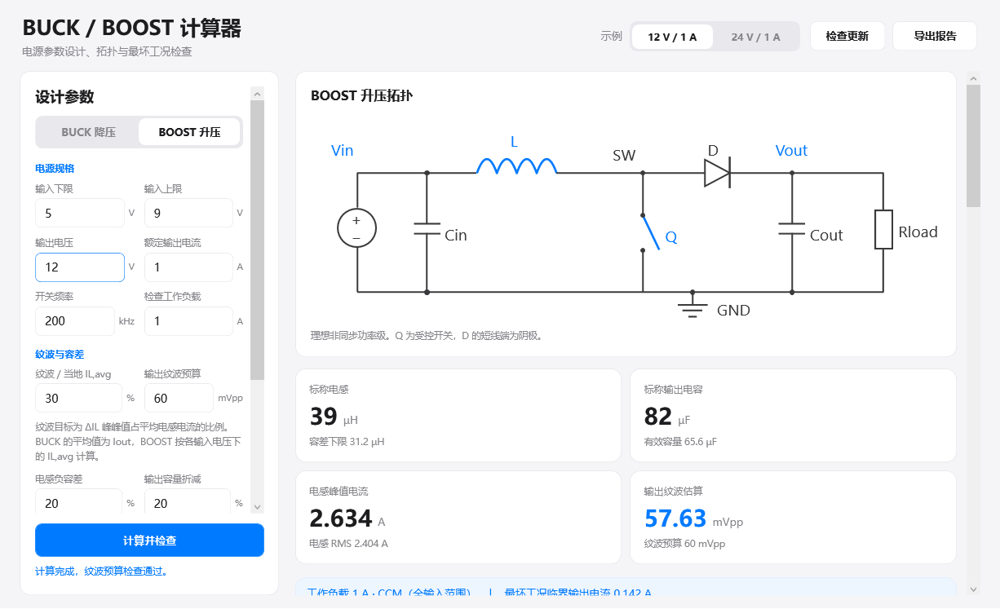

# BUCK / BOOST 计算器

中文 Windows 桌面工具，用于 BUCK 降压和 BOOST 升压电源的稳态参数初选与候选器件复核。选择电路模式，填写输入电压范围、输出规格、纹波预算和元件容差，即可查看拓扑图、电感、电容、电流应力及工作模式。




## 下载与运行

从 GitHub Release 下载 Windows x64 安装包，双击 MSI 完成安装，支持 Windows 10/11 64 位。安装后可从桌面或开始菜单启动程序。[下载最新版本](https://github.com/Epiphany-Lucky/buck-calculator/releases/latest)

| 附件 | 用途 |
|---|---|
| `BuckCalculator-v1.2.1-win-x64.msi` | 中文 Windows 安装程序 |
| `SHA256SUMS.txt` | MSI 安装包的 SHA-256 校验值 |
| `update.json` | 软件更新使用的版本、下载地址、大小与校验信息 |

程序为当前 Windows 用户安装，默认位置为 `%LocalAppData%\Programs\BuckCalculator`。安装过程创建桌面和开始菜单快捷方式，Windows“设置 → 应用 → 已安装的应用”中提供卸载入口。升级沿用原安装目录。

安装程序和卸载入口显示为“BUCK / BOOST 计算器”。桌面与开始菜单快捷方式沿用“BUCK 计算器”，升级后由同一入口启动双模式应用。

在 PowerShell 中执行以下命令可查看本地下载文件的校验值，并与 `SHA256SUMS.txt` 比较。

```powershell
Get-FileHash -Algorithm SHA256 -LiteralPath '.\BuckCalculator-v1.2.1-win-x64.msi'
```

## 软件内更新

程序在启动时及运行期间每 6 小时查询一次 GitHub 最新稳定版 Release 附件中的静态 `update.json`。清单提供版本、MSI 下载地址、大小、SHA-256 和升级说明。发现新版本后显示更新提示，也可以通过界面中的“检查更新”手动查询。

选择下载安装后，程序下载对应的 Windows x64 MSI，并用清单提供的 SHA-256 校验下载内容。下载和校验完成后，更新助手等待当前程序退出，运行 Windows Installer 完成升级，随后从安装目录重新启动应用。更新检查采用客户端定期轮询，联网状态和 GitHub 下载服务可用性会影响检查时间。静态清单返回 404 时，程序尝试通过 GitHub API 查询稳定版 Release。

## 主要功能

- 切换 BUCK 降压和 BOOST 升压计算，查看随模式更新的电路拓扑图与计算关系。
- 按输入电压上下限计算占空比范围。
- 根据目标电感纹波与负容差计算标称电感需求，自动选择标准值，支持填写候选电感。
- 计算最坏工况电感纹波、峰值、谷值、RMS 电流及开关器件电流应力。
- 纳入输出电容有效容量折减和 ESR，计算电容需求及保守纹波估算，支持填写候选电容。
- 计算输入电容的一阶容量需求和纹波 RMS 电流，检查完整输入区间的极值。
- BOOST 额外显示整流二极管电流、输出电容 RMS 电流与理想器件耐压需求。
- 检查额定负载与指定工作负载的 CCM 适用性，显示标明输入工况的额定负载电感电流波形。
- 导出包含输入参数、计算结果和假设说明的 Markdown 或 CSV 报告。

## 输入参数

| 参数 | 单位 | 含义 |
|---|---|---|
| 最低／最高输入电压 | V | BUCK 要求最低输入高于输出，BOOST 要求最高输入低于输出 |
| 输出电压 | V | 期望稳态输出电压 |
| 最大输出电流 | A | 元件初选所用额定负载 |
| 工作负载电流 | A | 用于检查指定负载下的导通模式 |
| 开关频率 | kHz | 固定开关频率 |
| 电感纹波目标 | % | BUCK 按额定输出电流，BOOST 按各输入工况的平均电感电流定义纹波比例 |
| 输出纹波预算 | mVpp | 稳态输出纹波允许峰峰值 |
| 电感负容差 | % | 标称电感到最小电感的折减比例 |
| 电容容量折减 | % | 标称输出电容到有效容量的折减比例 |
| 输出电容 ESR | mΩ | 输出电容组合的等效串联电阻 |
| 候选电感 | µH | 填 `0` 时自动选择，正数用于复核 |
| 候选输出电容 | µF | 填 `0` 时自动选择，正数用于复核 |
| 输入纹波预算 | mVpp | 输入电容容量估算使用的允许纹波 |

容量折减应结合器件的直流偏压、温度、容差与老化数据填写。电感负容差应结合实际电流偏置下的最小有效电感填写。

## BUCK 计算模型

程序采用理想、固定频率、连续导通模式的 BUCK 稳态模型，电感电流为三角波。所有下列公式使用 SI 单位。界面中的 kHz、µH、µF、mΩ 和 mV 会在计算时转换。

$$
D=\frac{V_o}{V_{in}},\qquad L_{min}=L_{nom}(1-t_L)
$$

$$
\Delta I_L=\frac{V_o(1-D)}{L_{min}f_s},\qquad I_{pk}=I_o+\frac{\Delta I_L}{2}
$$

$$
I_{valley}=I_o-\frac{\Delta I_L}{2},\qquad I_{L,rms}=\sqrt{I_o^2+\frac{\Delta I_L^2}{12}}
$$

$$
C_{eff}=C_{nom}(1-t_C),\qquad \Delta V_{o,estimate}=\frac{\Delta I_L}{8f_sC_{eff}}+\Delta I_L\cdot ESR
$$

其中输出纹波采用容量项与 ESR 项之和作为保守工程估算。电感纹波最坏工况取最高输入与最小电感，CCM 临界电流为纹波峰峰值的一半。电感与输出电容公式参照厂商 BUCK 功率级设计资料。[ADI 功率级设计说明](https://www.analog.com/en/resources/app-notes/2022/11/22/06/53/buck-power-stage-design-equations.html)

$$
C_{in,eff}\geq\frac{I_oD(1-D)}{f_s\Delta V_{in}},\qquad I_{Cin,rms}=\sqrt{I_o^2D(1-D)+\frac{D\Delta I_L^2}{12}}
$$

输入电容容量公式采用矩形电流近似，容量需求在 D=0.5 或区间端点处达到最大。输入 RMS 电流额外保留电感三角纹波项，最大值在完整输入范围内求取。上下管 RMS 电流分别按导通占空比加权。输入电容实际选型还需核对有效容量、ESR、纹波电流额定值和输入源阻抗。[TI 输入与输出电容选型说明](https://www.ti.com/lit/an/slta055/slta055.pdf)

当指定负载低于 CCM 临界电流时，界面提示 DCM，并说明所显示额定工况计算的适用条件。实际轻载波形取决于控制器的二极管仿真、PFM 或强制连续导通策略。器件压降、寄生参数、磁芯损耗、热设计、环路稳定性和负载瞬态需要结合具体器件进一步核验。

## BOOST 计算模型

BOOST 使用理想固定频率 CCM 模型，效率取 1。令 `x = Vin/Vout = 1−D`，`Io` 为额定输出电流，`r` 为该输入工况的电感纹波峰峰值。电感负容差与输出电容折减的定义沿用 BUCK 模式。

$$
D=1-\frac{V_{in}}{V_o},\qquad A=I_{L,avg}=\frac{I_o}{x}
$$

$$
r=\Delta I_L=\frac{V_{in}D}{L_{min}f_s},\qquad P=I_{L,peak}=A+\frac{r}{2},\qquad B=I_{L,valley}=A-\frac{r}{2}
$$

$$
I_{L,rms}=\sqrt{A^2+\frac{r^2}{12}},\qquad I_{o,boundary}=\frac{xr}{2}
$$

BOOST 的电感纹波比例为 `r/A`。自动电感选值覆盖完整输入范围，绝对纹波最大点可位于 `Vin = Vout/2`，相对纹波和输出侧 CCM 边界最大点可位于 `Vin = 2Vout/3`，程序将候选点限制到用户输入区间并与端点一起检查。电流应力的各项极值分别计算，波形采用同一输入工况的平均值、峰谷值、纹波与占空比。

输出电容在一个周期内的充放电电荷摆幅按三角电感电流分段计算，覆盖低占空比时整流导通末段电容仍会放电的情况。

$$
Q_{pp}=\begin{cases}
\dfrac{I_oD}{f_s},& B\geq I_o\\[6pt]
\dfrac{x(P-I_o)^2}{2rf_s},& B<I_o
\end{cases}
$$

$$
\Delta V_{C,pp}=\frac{Q_{pp}}{C_{eff}},\qquad \Delta V_{ESR,pp}=P\cdot ESR
$$

程序将两项之和作为输出纹波保守预算，先扣除 ESR 占用，再计算所需标称输出电容并计入容量折减。基础升压功率级关系与器件选型说明参照 TI SLVA372D，分段电荷关系由本项目按 CCM 三角电流积分计算。[TI 升压功率级计算说明](https://www.ti.com/lit/an/slva372d/slva372d.pdf)

$$
I_{Q,rms}=\sqrt{D\left(A^2+\frac{r^2}{12}\right)},\qquad I_{D,rms}=\sqrt{x\left(A^2+\frac{r^2}{12}\right)}
$$

$$
I_{Cout,rms}=\sqrt{I_o^2\frac{D}{x}+\frac{xr^2}{12}},\qquad I_{Cin,rms}=\frac{r}{\sqrt{12}}
$$

$$
C_{in,eff}\geq\frac{\Delta I_{L,max}}{8f_s\Delta V_{in}}
$$

输入电容容量采用输入源提供平均电流、电容承受三角纹波的初估。控制器推荐的最小容量、有效容量降额、输入 ESR 与供电源阻抗需进一步核对。理想 BOOST 开关和整流二极管的电压应力为输出电压，二极管平均电流为输出电流，峰值电流按电感峰值检查，实际器件选型需结合尖峰和设计裕量。

指定负载的输出电流与全输入区间最坏输出侧 CCM 边界比较。轻载 DCM 时，当前显示的额定 CCM 参数和波形仅用于额定初选，轻载实际占空比及波形需结合 DCM 模型与控制器策略分析。拓扑图展示理想非同步功率级及元件连接关系。

## BUCK 默认算例

默认输入范围为 9–16 V，输出为 5 V / 2 A，频率为 200 kHz，电感纹波目标为 30%，电感负容差为 20%，输出纹波预算为 20 mVpp，容量折减为 20%，ESR 为 5 mΩ。

选择候选电感 33 µH 时，最小电感为 26.4 µH，最高输入下电感纹波约为 0.6510 App，峰值约为 2.3255 A，RMS 约为 2.0088 A。自动电感选择会将负容差纳入目标复核，因此其选值可高于 33 µH。

保持全部默认参数并自动选值时，选择 39 µH 电感与 27 µF 输出电容，预计输出纹波约为 18.6943 mVpp。

## 从源码构建

开发环境使用 Windows 和 .NET 10 SDK。项目使用 WPF 及 .NET 标准库。

```powershell
git clone https://github.com/Epiphany-Lucky/buck-calculator.git
Set-Location -LiteralPath '.\buck-calculator'
dotnet run --project '.\src\BuckCalculator\BuckCalculator.csproj'
```

执行计算、更新和界面验证，并构建安装包。

```powershell
.\scripts\build.ps1 -Version 1.2.1
```

构建脚本先运行计算、报告与更新检查，再将 Windows x64 自包含应用封装进 WiX 6.0.2 MSI。程序运行所需的 .NET 运行时包含在应用中。输出位于 `artifacts`，包括 MSI、SHA-256 文件和基于本次 MSI 哈希及大小生成的 `update.json`，界面验证结果位于 `artifacts/smoke-test`。[Microsoft 自包含与单文件部署说明](https://learn.microsoft.com/en-us/dotnet/core/deploying/single-file/overview)

加入 `-VerifyInstall` 可进一步执行隔离安装验证。脚本生成内部使用的 1.0.9 测试版本，在 `artifacts/installer-test/app` 安装后调用软件更新助手升级到目标 MSI，检查原安装目录保留、旧产品注销、自动重启、降级阻止和卸载清理。检测到现有用户安装或快捷方式时会记录跳过结果。

```powershell
.\scripts\build.ps1 -Version 1.2.1 -VerifyInstall
```

也可以单独执行计算验证。

```powershell
dotnet run --project '.\tests\BuckCalculator.Checks.csproj' --configuration Release
dotnet run --project '.\tests\BuckCalculator.UpdateChecks.csproj' --configuration Release
```

## GitHub 自动发布

推送到 `main` 会运行构建验证并保留可下载的 Actions 安装包。推送 `v*` 标签会在验证成功后创建 GitHub Release，并上传 MSI、校验文件和静态更新清单。已存在的同名 Release 会更新安装附件。

```powershell
git tag v1.2.1
git push origin v1.2.1
```

## 源码使用

仓库提供计算实现与构建流程，方便检查结果。源码授权以仓库后续明确提供的许可证为准。
